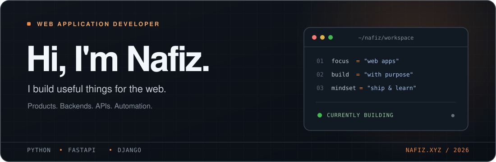

  

  <a href="https://nafiz.xyz/"><b>Portfolio</b></a> &nbsp; / &nbsp;
  <a href="https://www.linkedin.com/in/md-nafis-uddin-98949530a/">LinkedIn</a> &nbsp; / &nbsp;
  <a href="mailto:nafizuddin1537@gmail.com">Email</a>

I'm **Nafiz**, a web application developer and computer science student. I turn ideas into useful software—mostly with **Python, FastAPI, and Django**. I like building real products, connecting APIs, and automating the work behind the scenes.

My focus is straightforward: **build with purpose, ship thoughtfully, and keep improving.**

---

## 01 — Selected work

A few things I've built, from learning platforms to backend integrations and automation.

### PromptForge Academy
**Learning platform** · FastAPI / SQLAlchemy / Jinja2

A seven-module prompt-engineering course with lessons, quizzes, XP, leaderboard, completion certificates, phone OTP sign-in, and carrier billing.

[**Live website ↗**](https://academy.nafiz.xyz/) &nbsp;·&nbsp; [Source code](https://github.com/nafiz-byte/promptforge-academy)

<table>
  <tr>
    <td width="50%" valign="top">
      
      <h3>QuizFy</h3>
      
<b>Quiz application</b> · Django / PostgreSQL

      
AI-generated Bangla quizzes, topic-based practice, OTP sign-in, subscription billing, and a leaderboard.

      <a href="https://github.com/nafiz-byte/quizfy">Explore project ↗</a>
    </td>
    <td width="50%" valign="top">
      
      <h3>bdapps Revenue Agent</h3>
      
<b>Reporting automation</b> · Python / pytest / GitHub Actions

      
Collects app revenue across multiple developer accounts and delivers a single Telegram report.

      <a href="https://github.com/nafiz-byte/bdapps-agent">Explore project ↗</a>
    </td>
  </tr>
</table>

**Also explored:** [nasaPics](https://github.com/nafiz-byte/nasaPics) · [Chatbot AI](https://github.com/nafiz-byte/Chatbot_Ai)

---

## 02 — Under the hood

I enjoy the less visible parts of great web apps: authentication, clean APIs, subscription flows, background jobs, and reliable integrations.

**An example from my work:** integrating bdapps OTP, subscription, and carrier-billing APIs with Django and FastAPI apps, handling callbacks, and automating revenue reporting across developer accounts.

---

## 03 — My toolkit

**Core** &nbsp; Python · FastAPI · Django · SQLite · Git · Linux

**Used in projects** &nbsp; PostgreSQL · SQLAlchemy · Jinja2 · REST APIs · pytest · GitHub Actions

**Learning further** &nbsp; Docker · AWS · data structures and algorithms

Also familiar with C and Java.

---

## 04 — Let's build something useful

I'm always interested in thoughtful products, engineering problems, and learning with other builders.

**[Explore my portfolio ↗](https://nafiz.xyz/)** &nbsp;·&nbsp; **[Say hello](mailto:nafizuddin1537@gmail.com)**

Build with purpose. Ship. Learn. Repeat.
